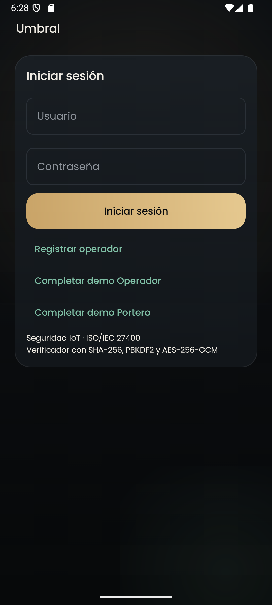
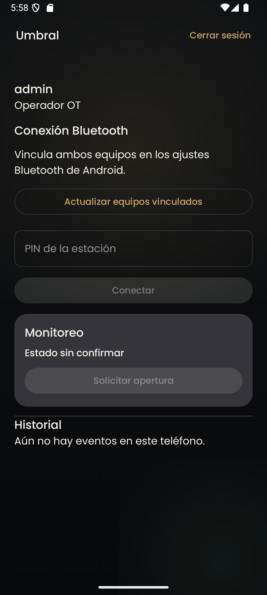
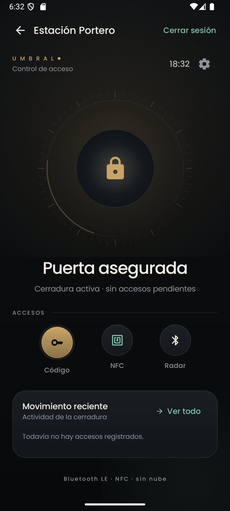

# Umbral

Umbral es una app Android para monitorear y operar una puerta simulada mediante Bluetooth. Dos teléfonos ejecutan la misma APK con perfiles distintos. El **Operador OT** solicita la apertura y el **Portero** confirma el estado, simula el actuador y registra eventos.

[Descargar la APK de demostración para Android](https://github.com/MarceloDh/Umbral/releases/download/v1.0.0/Umbral-v1.0.0-debug.apk)

## Compilación

Abre esta carpeta en Android Studio y sincroniza Gradle. El proyecto incluye Gradle Wrapper 8.13, usa Android SDK 36 y compila con Java 17. El mínimo es Android 8.0 (API 26).

```powershell
.\gradlew.bat assembleDebug
```

```bash
./gradlew assembleDebug
```

La APK está en `app/build/outputs/apk/debug/app-debug.apk`. El identificador es `com.marcelodh.umbral`. Android instala esta APK como una aplicación independiente de versiones con otro identificador y mantiene sus datos separados.

## 1. Problemática y dispositivos (2.1.1.1)

En una zona operativa, solicitar una apertura sin conocer el estado del acceso dificulta la coordinación y la trazabilidad. Umbral modela esa situación con dos teléfonos vinculados. El **Terminal Operador** envía órdenes. La **Estación Portero** simula la puerta, decide si procede la orden y confirma el estado. Un teléfono con lector NFC puede verificar un tag vinculado y uno con BLE puede detectar anuncios de una baliza o de otro dispositivo compatible. El actuador remoto se representa en pantalla.

## 2. Funciones (2.1.1.2)

- Registro e inicio de sesión local con roles de Operador OT y Portero. El panel muestra la cuenta activa y permite cerrar sesión.
- Enlace bidireccional entre dispositivos vinculados con verificación del PIN de la estación. El Operador solo muestra estados confirmados por el Portero y vuelve a **Estado sin confirmar** si pierde el enlace o vence la espera.
- Solicitud de apertura, cierre automático remoto a los cuatro segundos y eventos de presencia simulada desde la estación.
- Herramientas locales del Portero para cambiar el PIN, validar el código, leer o vincular una tarjeta NFC y observar detecciones BLE por RSSI. Se accede desde **Herramientas de la estación** antes de iniciar el enlace. El sensor y la puerta de la demostración remota tienen su propio flujo simulado.
- Bitácora SQLite de solicitudes, confirmaciones, presencia y accesos locales. El panel y las herramientas consultan la misma base en el teléfono que produjo el evento.

## 3. Herramientas y arquitectura Android (2.1.1.3)

Android Studio permite compilar, instalar y depurar la APK en emulador y equipos físicos. Kotlin modela roles y estados mediante tipos explícitos. Jetpack Compose y Material 3 mantienen el tema oscuro y la tipografía Poppins. Los ViewModel exponen los historiales como `StateFlow`, observados con el ciclo de vida de la pantalla. Las corrutinas ejecutan las consultas SQLite y la lectura y escritura RFCOMM en segundo plano.

`SQLiteOpenHelper` administra el esquema versionado de `usuarios` y `eventos_acceso`. SQLite sirve para consultar datos sin red y mantener una bitácora por dispositivo. `EncryptedSharedPreferences` conserva el PIN derivado, los ajustes y la tarjeta vinculada. El proyecto usa la versión de AndroidX Security solicitada para el ejercicio. AndroidX marcó esa API como obsoleta en la rama 1.1 y recomienda usar Android Keystore directamente para implementaciones nuevas. [Notas de AndroidX Security](https://developer.android.com/jetpack/androidx/releases/security)

## 4. Comunicación inalámbrica (2.1.2.5)

| Opción | Distancia | Consumo | Estabilidad y operación |
| --- | --- | --- | --- |
| Bluetooth LE y RFCOMM clásico | BLE permite estimar cercanía mediante RSSI. Se propone ensayar a 1, 5 y 10 m. RFCOMM puede alcanzar más según el entorno. | BLE sirve para anuncios de bajo consumo. El escaneo sostenido y el enlace RFCOMM también consumen energía. | RFCOMM intercambia órdenes directamente entre los teléfonos vinculados, sin router ni Internet. |
| Wi-Fi | La cobertura depende del punto de acceso, los obstáculos y la red. Puede extenderse más allá del acceso físico. | Depende de la actividad de radio, el tráfico y el equipo. | Una red local ofrece más ancho de banda. El modo de infraestructura depende del punto de acceso y de su configuración. |
| MQTT | Es un protocolo de mensajería sobre una red. El alcance lo determina el transporte. | Depende de la red y del patrón de publicación. | Facilita comunicación entre varios nodos mediante un bróker. En una instalación local puede operar sin Internet si el bróker está disponible. |

Bluetooth encaja con el intercambio local de pocos mensajes. RSSI es un indicio de proximidad sensible a obstáculos y orientación. La aplicación usa la sesión, el par seleccionado y el PIN para autorizar la apertura remota. Para evaluar el rango de 1 a 10 m, repite solicitudes y registra confirmaciones, pérdidas de enlace y latencia. Las distancias indicadas son puntos de ensayo. [Conexiones Bluetooth en Android](https://developer.android.com/develop/connectivity/bluetooth/connect-bluetooth-devices)

## 5. Controles de seguridad IoT (2.1.3.10)

- **Credenciales.** La contraseña se preprocesa con SHA-256 con separador estático de aplicación, se deriva con PBKDF2-HMAC-SHA-256 y sal aleatoria por cuenta, y se protege con AES-256-GCM usando Android Keystore. SQLite conserva el verificador cifrado. Tres errores por cuenta activan una espera persistente de un minuto.
- **PIN.** SHA-256 deriva un verificador con dominio separado. `EncryptedSharedPreferences` usa una `MasterKey` AES-256-GCM. Ante un fallo del almacén, el PIN y la tarjeta quedan inaccesibles y el acceso se rechaza. El PIN se configura en la estación y cinco fallos activan un bloqueo persistente de 30 segundos.
- **Bluetooth.** Ambos teléfonos generan desafíos aleatorios y demuestran conocimiento del PIN con HMAC-SHA-256. Cada dirección usa un dominio distinto. El PIN y su hash se mantienen fuera de la trama. Solo tras verificar ambas pruebas se procesan órdenes en el socket RFCOMM seguro. La estación comprueba el dispositivo vinculado seleccionado. Un PIN de cuatro dígitos y un UID NFC son credenciales de baja entropía para esta simulación.
- **Sesión y permisos.** La sesión habilita el panel y el rol Portero habilita la estación y sus herramientas. El panel solicita `BLUETOOTH_CONNECT` para el enlace. El radar pide los permisos BLE aplicables y declara `neverForLocation` en Android 12+. Android puede filtrar algunos anuncios BLE con esa opción. [Permisos Bluetooth de Android](https://developer.android.com/develop/connectivity/bluetooth/bt-permissions)
- **Datos.** El manifiesto deshabilita backup y `reglas_datos.xml` excluye bases de datos y preferencias del backup y de la transferencia. La bitácora evita incluir contraseñas, PIN y UID completos. Es un historial local de la aplicación y no ofrece garantías de inmutabilidad.

Estos controles se documentan como aplicación de las directrices de seguridad y privacidad IoT de [ISO/IEC 27400:2022](https://www.iso.org/standard/44373.html).

## 6. Pruebas y demostración (2.1.3.11 y 2.1.4.12)

1. Instala la misma APK en dos teléfonos Android. En `debug`, utiliza **Completar demo Operador** en uno y **Completar demo Portero** en el otro. Las cuentas de demostración son `admin / admin1234` y `portero / umbral2026`. En `release`, configura el primer usuario y perfil de cada instalación. Las altas posteriores crean operadores.
2. Prueba una contraseña errónea, el bloqueo tras tres intentos y el ingreso después de un minuto. Verifica el nombre y rol visibles. Cierra sesión y comprueba el regreso al formulario.
3. Vincula los teléfonos desde Android. En el Portero, entra a **Herramientas de la estación → Ajustes**, configura un PIN y regresa al panel. Actualiza equipos, selecciona al Operador y pulsa **Iniciar espera**. En el Operador, selecciona el Portero, ingresa el PIN y pulsa **Conectar**. Repite con un PIN incorrecto para comprobar el rechazo.
4. Con el PIN correcto, verifica **Puerta asegurada** en el Operador. Solicita apertura. Confirma la transición a **Puerta abierta** y el cierre a los cuatro segundos. Envía presencia desde la estación y revisa ambos historiales. Repite con pérdida del enlace y confirma que el Operador invalida el estado.
5. En un Portero con NFC, vincula una tarjeta y contrasta su lectura con otra tarjeta. En el radar BLE, activa la vigilancia y acerca un emisor compatible. Comprueba que el evento local aparece en el historial. Para verificar SQLite en una compilación de depuración, abre **App Inspection → Database Inspector**, selecciona el proceso y consulta `eventos_acceso` en `umbral_enlace.db`.
6. Registra modelos, versiones de Android, resultados de cada prueba y observaciones del docente. La conexión de dos equipos, el hardware NFC/BLE y la demostración presencial requieren validación física.

### Verificación y capturas

En Android 15 (API 35) se comprobó el inicio de sesión con los dos perfiles, la restricción de las herramientas al Portero, el cierre de sesión y el guardado cifrado del PIN. `testDebugUnitTest` verifica el intercambio con PIN válido y el rechazo de un PIN incorrecto y de una firma de un desafío anterior.





El [mockup](docs/mockup.md) documenta la navegación y el monitoreo. La [guía TI3042 completada](docs/Gu%C3%ADa%20-%20Marcelo%20Ducommun%20Umbral.docx) describe cómo se aplicó cada actividad al proyecto. La fuente Poppins se distribuye con su [licencia](app/src/main/assets/licenses/Poppins-OFL.txt).
