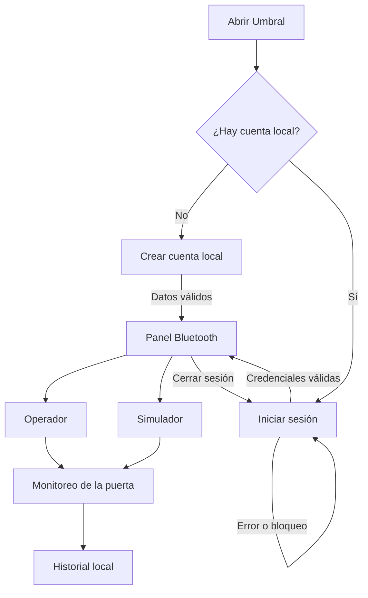
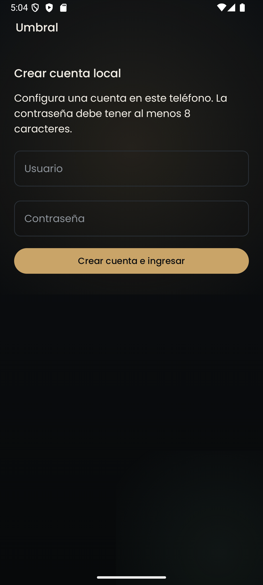
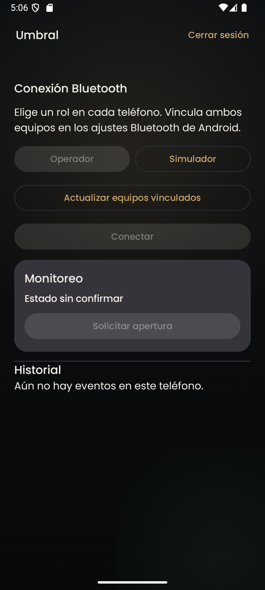

# Mockup de Umbral

La misma interfaz se instala en ambos equipos. El encabezado muestra **Umbral**. El panel se desplaza para llegar al historial y ofrece **Cerrar sesión** en el encabezado.



| Vista | Contenido y acciones | Respuesta visible |
| --- | --- | --- |
| Cuenta local | Usuario, contraseña oculta y botón para crear cuenta o ingresar | Error bajo el formulario, aviso de bloqueo o ingreso al panel |
| Conexión | Roles, actualización de equipos vinculados, selección y botón de conexión | Permiso requerido, lista vacía, espera, conexión o pérdida de enlace |
| Operador | Estado de la puerta y botón **Solicitar apertura** | Estado sin confirmar, puerta asegurada, esperando confirmación o puerta abierta |
| Simulador | Estado local y botón **Simular presencia** | Apertura temporal, cierre automático y confirmación de envío de presencia |
| Historial | Detalle, fecha y rol por evento, con el más reciente primero | Lista de registros locales, mensaje de historial vacío o error de lectura |

## Distribución de las pantallas

```text
┌────────────────────────────┐   ┌──────────────────────────────────┐
│ Umbral                     │   │ Umbral            Cerrar sesión │
│                            │   │                                  │
│ Iniciar sesión             │   │ Conexión Bluetooth               │
│ Usuario                    │   │ [Operador]       [Simulador]     │
│ Contraseña  ••••••••       │   │ [Actualizar equipos vinculados] │
│                            │   │ [Equipo seleccionado]           │
│ [Ingresar]                 │   │ [Conectar / Iniciar espera]      │
│ Aviso de acceso            │   │ Aviso de conexión                │
└────────────────────────────┘   │                                  │
                                 │ Monitoreo                        │
                                 │ Puerta asegurada                 │
                                 │ [Solicitar apertura]             │
                                 │                                  │
                                 │ Historial                        │
                                 │ Evento · fecha · rol             │
                                 └──────────────────────────────────┘
```

En el primer uso, el formulario muestra **Crear cuenta local** y la indicación de ocho caracteres como mínimo. En el rol Simulador, la tarjeta de monitoreo ofrece **Simular presencia**. La aplicación utiliza el tema oscuro del avance, texto claro y acciones resaltadas.

## Capturas del emulador




## Recorrido con dos dispositivos

1. En el Simulador, selecciona el Operador vinculado y pulsa **Iniciar espera**.
2. En el Operador, selecciona el Simulador vinculado y pulsa **Conectar**.
3. El Operador muestra **Puerta asegurada** al recibir el estado inicial. Cuando solicita abrir, muestra la espera y luego el estado confirmado por el Simulador.
4. El Simulador cierra la puerta y el Operador registra el cierre. La presencia aparece en el historial como evento independiente.
